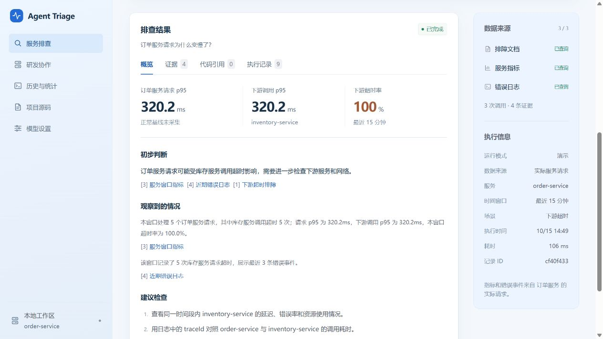
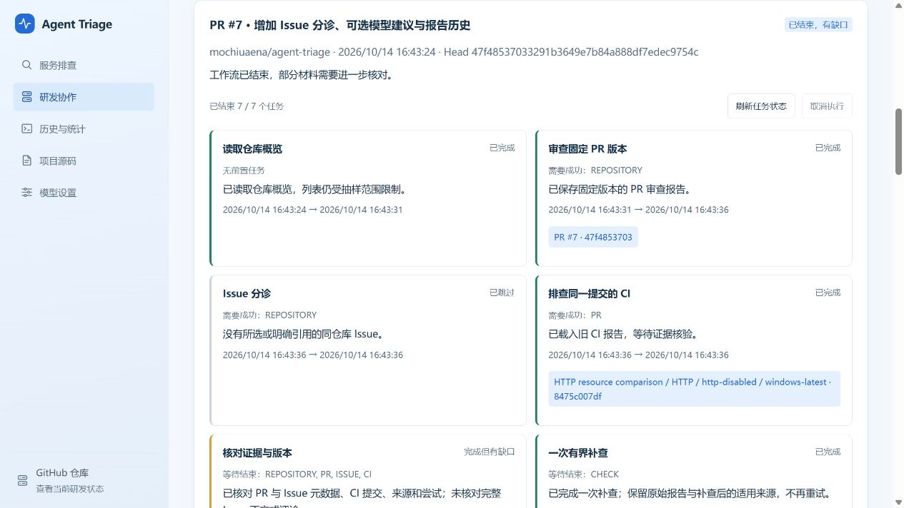

<div align="center">

# Agent Triage

**面向 Java 与 Spring Boot 的故障排查助手**

结合指标、日志、排障文档和源码，给出带证据的判断与下一步检查建议。

[](https://github.com/MoChiUaena/agent-triage/actions/workflows/ci.yml)
[](https://www.oracle.com/java/technologies/downloads/#java21)
[](https://spring.io/projects/spring-boot)
[](https://spring.io/projects/spring-ai)
[](https://github.com/MoChiUaena/agent-triage/releases)
[](LICENSE)

[快速开始](#快速开始) · [功能](#功能) · [接入服务](#接入自己的服务) · [文档](#文档) · [参与贡献](#参与贡献)

</div>

## 项目介绍

Agent Triage 帮助 Java 开发者排查慢请求、HTTP 下游超时和数据库访问异常。选择服务与时间窗口后，它读取实际观测，关联错误位置与本机源码，整理出可核查的证据和检查建议。也可以接入 GitHub 仓库，将 PR、Issue 与 CI 检查组合成带版本和来源的工作流。

无需模型密钥也能运行规则模式。启用模型后，由模型选择工具、判断类型和证据引用，再由应用核对观测并生成结论。项目提供独立的 Spring Boot 样例，以及用于接入现有应用的 Starter。



*当前主分支界面，截图于 2026-10-15。使用规则模式读取实际订单请求：5 次请求、5 次库存调用超时。已发布演示包的界面可能不同。*

## 功能

| 能力 | 可以做什么 |
| --- | --- |
| 服务排查 | 查询窗口指标与错误事件，核对 HTTP 下游超时、请求执行异常、连接池耗尽和 SQL 执行阶段失败 |
| 多下游观测 | 按依赖分别显示 HTTP 请求、超时、p95 和响应类别，区分同一请求中的多个下游 |
| 源码定位 | 按类、方法和接口检索 Java 项目，将观测关联到接口入口、业务错误行和静态调用关系，核对构建源码摘要 |
| Spring Boot 接入 | 通过 Starter 提供只读观测接口，支持 MVC、HTTP、JDBC，以及显式接入的 JPA 与异步上下文观测 |
| 模型配置 | 在页面添加、测试和切换模型，提供 DeepSeek、百炼、GLM、Kimi、LM Studio 与兼容接口预设 |
| 排查记录 | SSE 实时进度、证据引用、主动取消、历史筛选、事件重放和模型用量统计 |
| 本机存储 | H2 开箱即用，也可切换 PostgreSQL；模型密钥加密保存，源码发送单独授权 |
| GitHub 协作 | 仓库概览、CI 日志排障、固定版本 PR 审查、Issue 分诊和带依赖的协同工作流 |

### GitHub 研发协作

从“研发协作”登记仓库，查看 Issue、PR 和默认分支 CI，也可按 PR 编号生成协同检查计划。页面展示任务依赖、执行状态、版本核验和综合报告，所有 GitHub 请求只读。使用方法见[研发协作说明](docs/DEVELOPMENT_COLLABORATION.md)和[工作流说明](docs/DEVELOPMENT_WORKFLOWS.md)。当前源码已包含这些功能；v0.11.0 演示包仍保留原版本内容。

<details>
<summary>查看当前协同工作流界面</summary>



图为当前研发协作页面中已保存的 PR 检查记录，展示任务依赖、执行状态与报告入口。

</details>

早期版本的订单与源码演示录像保留在[演示记录](docs/DEMO.md)，其中界面不代表当前开发版。

## 快速开始

### 下载演示包

需要 **JDK 21+**。从 [v0.11.0 预览版](https://github.com/MoChiUaena/agent-triage/releases/tag/v0.11.0)下载 `agent-triage-0.11.0-demo.zip`，完整解压后运行：

**Windows**

```powershell
powershell -ExecutionPolicy Bypass -File .\start-demo.ps1
```

**macOS / Linux**（需要 Bash 和 curl）

```bash
bash start-demo.sh
```

打开 <http://127.0.0.1:18080>，选择订单服务，生成正常请求或触发库存超时，再开始排查。演示包统一启动 Agent 和样例服务，默认读取真实本机请求，无需 API Key。按 `Ctrl+C` 一起停止。

数据库、日志和模型设置保存在解压目录。端口、源码演示和升级方法见[版本说明](docs/releases/v0.11.0.md)。

### 从源码运行

需要 **JDK 21+** 和 Git。仓库自带 Maven Wrapper，首次运行会下载构建依赖。

**Windows**

```powershell
git clone https://github.com/MoChiUaena/agent-triage.git
cd agent-triage
.\mvnw.cmd spring-boot:run
```

**macOS / Linux**

```bash
git clone https://github.com/MoChiUaena/agent-triage.git
cd agent-triage
./mvnw spring-boot:run
```

打开 <http://127.0.0.1:18080>，输入“订单查询接口为什么变慢了？”，尝试“下游超时”和“正常对照”两个场景。源码启动默认使用规则模式和明确标记的合成数据。

打包运行、真实请求样例、PostgreSQL 和常用配置见[运行指南](docs/RUNNING.md)。

## 接入自己的服务

1. **接入观测。** 使用 [Spring Boot Starter](docs/STARTER.md)，或实现[服务观测协议](docs/SERVICE_INTEGRATION.md)。在 Agent 配置中登记服务后，可在页面选择它。
2. **绑定源码。** 在“项目源码”登记本机 Java 项目并绑定服务，运行“检查接入”，核对观测、源码入口和构建版本。方法见[源码接入](docs/SOURCE_INTEGRATION.md)。
3. **生成实际请求。** 查询有请求的时间窗口，在结果中核对指标、错误事件和代码引用。已有 [Spring Petclinic 接入示例](docs/PETCLINIC.md)可参考。

接入前可阅读[应用接入与运行限制](docs/APPLICATION_ADOPTION.md)，按需要选择 HTTP、数据库或入站请求观测。Agent 读取的是约定的观测接口，服务需要提供对应数据。

### 启用模型

打开本机“模型设置”页面，添加服务地址、模型名称和 API Key，测试连接后选择当前模型。支持的协议、供应商预设、调用限制与费用说明见[模型配置](docs/MODELS.md)。

启用模型会向所选服务发送排查上下文；源码发送还需单独授权。模型调用受轮次、工具次数和时限限制，应用会校验判断与证据引用，证据不足时不会给出完整判断。

## 工作方式

一次排查经过：**提交问题 → 读取观测与文档 → 校验判断和引用 → 展示证据与检查建议 → 保存记录**。

规则模式执行固定的只读工具；模型模式通过 Spring AI 选择工具和有效证据。源码检索补充本机代码位置，构建摘要用于检查运行代码与索引是否对应。执行记录保存在 H2 或 PostgreSQL，页面通过 SSE 接收进度。

当前面向本机单实例使用，尚无多用户鉴权、集群任务协调或自动修复。工具不执行任意 Shell 或 SQL。结果描述所选窗口中已采集的现象与异常阶段，仍需开发者核对业务根因。

## 项目结构

```text
src/                       Agent 服务、网页、工具与执行记录
triage-spring-boot-starter/ Spring Boot 观测接入组件
sample-service/            订单请求样例
inventory-service/         HTTP 下游样例
database-service/          HikariCP / H2 数据库样例
catalog-service/           Starter 接入样例
verification/              独立工单服务与接入验证项目
docs/                      接入、架构、版本与验证说明
```

## 文档

| 我想了解 | 文档 |
| --- | --- |
| 项目用途、运行模式与页面结果 | [项目导览](docs/PROJECT_GUIDE.md) |
| 安装、数据库与常用配置 | [运行指南](docs/RUNNING.md) |
| 接入现有 Spring Boot 应用 | [接入选择](docs/APPLICATION_ADOPTION.md) · [Starter](docs/STARTER.md) · [观测协议](docs/SERVICE_INTEGRATION.md) |
| 将请求与源码位置关联 | [源码接入](docs/SOURCE_INTEGRATION.md) · [Petclinic 示例](docs/PETCLINIC.md) |
| 配置模型与控制调用 | [模型配置](docs/MODELS.md) · [判断契约](docs/MODEL_OUTPUT.md) |
| 排查具体场景 | [HTTP 请求链路](docs/LIVE_LAB.md) · [数据库连接池](docs/DATABASE_POOL.md) · [入站请求](docs/INBOUND_HTTP.md) |
| 阅读设计和接口 | [架构](docs/ARCHITECTURE.md) · [API](docs/API.md) |
| 查看测试和评测 | [测试说明](docs/VALIDATION.md) · [小规模评测](docs/EVALUATION.md) |
| 查看版本与后续开发 | [更新记录](CHANGELOG.md) · [开发计划](docs/ROADMAP.md) · [Releases](https://github.com/MoChiUaena/agent-triage/releases) |

## 开发与测试

```powershell
# Windows
.\mvnw.cmd verify
```

```bash
# macOS / Linux
./mvnw verify
```

默认测试无需模型密钥。CI 覆盖 Windows、Linux 与 PostgreSQL，检查工具参数、证据引用、执行限额、取消和恢复；实际模型评测单独运行，详见[测试说明](docs/VALIDATION.md)。

## 参与贡献

欢迎提交问题、改进文档、补充观测接入和排查场景。

- 反馈问题或提出建议：[GitHub Issues](https://github.com/MoChiUaena/agent-triage/issues)。请附版本、运行方式、复现步骤和已脱敏的错误信息。
- 提交修改：阅读[贡献指南](CONTRIBUTING.md)，在 PR 中说明改动和验证方式。
- 分享接入经验：说明使用的 Spring Boot 版本、观测类型和复现项目，便于其他开发者复用。

请勿提交真实业务日志、API Key、本地数据库或包含凭据的配置文件。

## 许可证

项目采用 [MIT License](LICENSE)。

任务追问：从五类保存报告连续询问依据、查看固定引用并恢复历史；无模型仍可保存问题和阅读原依据。完整链路和授权边界见 [docs/CONVERSATIONS.md](docs/CONVERSATIONS.md)。

用户确认的本机项目经验：见 [项目记忆（M1/M2）](docs/PROJECT_MEMORY.md)。支持不可变版本、明确确认、消息候选、按问题召回、冲突提示与单独确认外发；无向量检索或自动注入。

可选的项目知识向量与混合检索（K3）：见[项目知识说明](docs/PROJECT_KNOWLEDGE.md)。可在模型设置配置独立的 Embedding / Rerank 服务，按范围有界建立向量索引并以 RRF 融合关键词与向量召回；发送范围逐项展示并需单独确认，未配置时关键词检索与既有功能不变。

CI 模型辅助分析（A1）：见[研发协作说明](docs/DEVELOPMENT_COLLABORATION.md)。在规则报告之上按需生成模型建议——预览脱敏错误块与作业身份、确认后发送、引用校验、失败保留规则报告；不自动重跑 CI 或修改代码。

PR 模型辅助审查（A2）：见[研发协作说明](docs/DEVELOPMENT_COLLABORATION.md)。按报告冻结 SHA 预览脱敏差异范围，源码补丁单独授权；建议经文件、行号与 SHA 校验，区分变更意图、风险与测试缺口，PR 更新即失效，不构成合入批准。

受限本机源码上下文（S1）：PR 模型建议可附带已登记本机索引的限量摘录与静态调用候选；变更行与 PR head 抽样核对版本，不一致即不采用，静态候选、歧义与不可用分开标识，反射等未知路径保持未知。

Issue 上下文补全（A3）：见[研发协作说明](docs/DEVELOPMENT_COLLABORATION.md)。Issue 分诊读取最近五条评论（纳入预览指纹）、可选本机符号候选与 CODEOWNERS 负责人线索；评论提及不构成因果或推荐，分诊不等于复现成功。

仓库健康摘要（R0）：见[研发协作说明](docs/DEVELOPMENT_COLLABORATION.md)。按规则汇总概览快照与本机分析记录——来源、抽样范围与缺口逐项标注，快照过期提示更新，可保存与重开；生成不访问 GitHub、不调用模型。

研发活动报告（R1）：见[研发协作说明](docs/DEVELOPMENT_COLLABORATION.md)。按日期范围（日报/周报）整理提交、Issue、PR、CI 与本机分析记录——按日分组、每项活动可跳转来源或重开本机报告，待处理事项与读取缺口逐条标注，空范围与读取失败区分；支持历史重开与 Markdown 本机导出，不自动发送邮件或评论，回写知识库选项未启用。

GitHub 操作草稿（W1 首轮）：见[研发协作说明](docs/DEVELOPMENT_COLLABORATION.md)。从已保存的 Issue 分诊 / PR 审查报告生成本机评论与标签草稿——依据与目标版本随草稿保存，可编辑（修订校验）可丢弃；草稿明确「未执行」，生成与编辑不调用任何 GitHub 接口。

草稿确认执行与审计（W2 首轮）：见[研发协作说明](docs/DEVELOPMENT_COLLABORATION.md)。评论与标签草稿经执行预览（目标/内容/影响/权限/版本核对）与显式确认后执行——独立写入凭据（默认关闭）、执行前二次核对目标变化、原子占位防重复提交，超时先核对远端不自动重试；每次尝试写入本机审计（不保存凭据），不提供任意请求或自动合并。

可配置的工作流模板（F1 首轮）：见[研发协作说明](docs/DEVELOPMENT_COLLABORATION.md)。固定 PR 模板之外，从受控任务目录勾选组合保存为模板（服务端校验依赖环、缺失引用与材料约束）；执行按创建计划时冻结的任务快照进行，模板修改不影响在途任务，固定模板及其限额保持原样。
